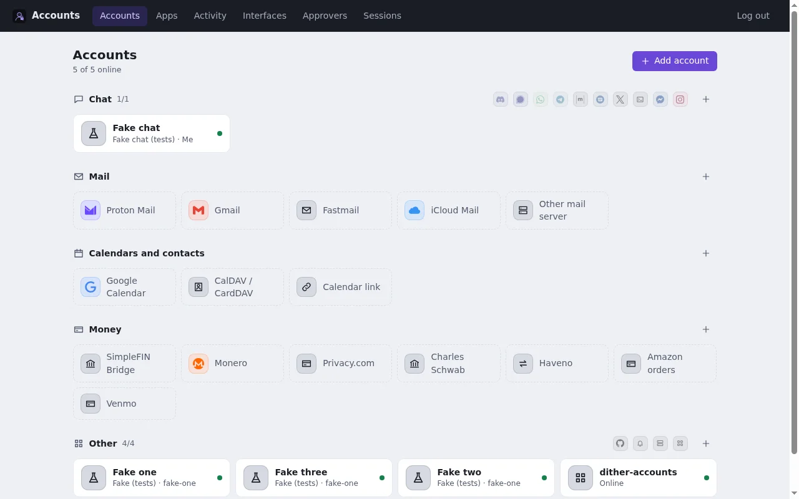
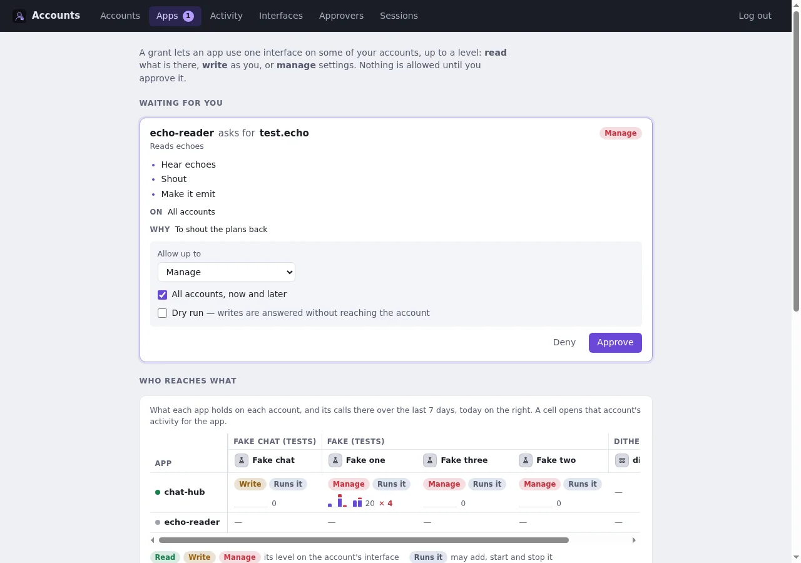
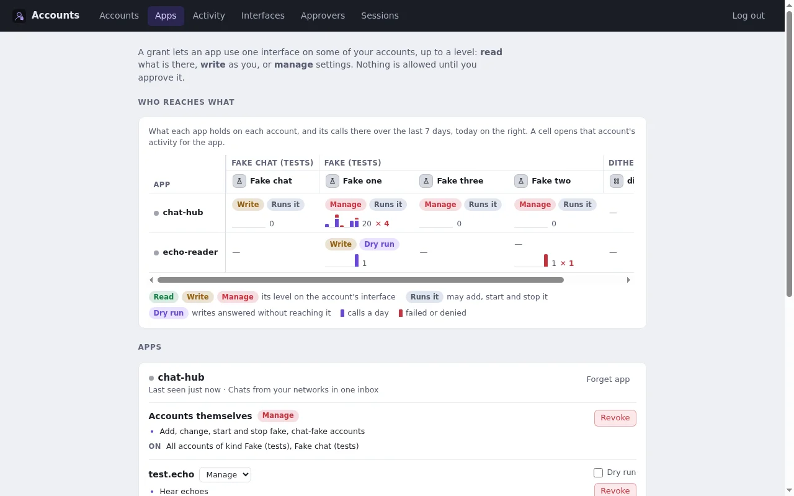
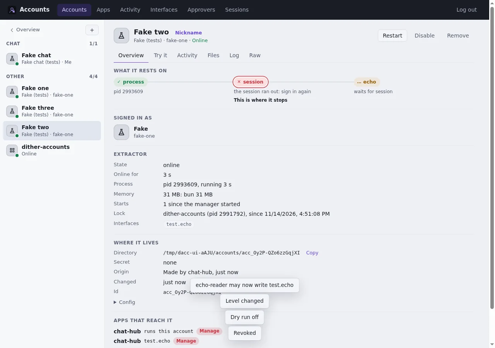
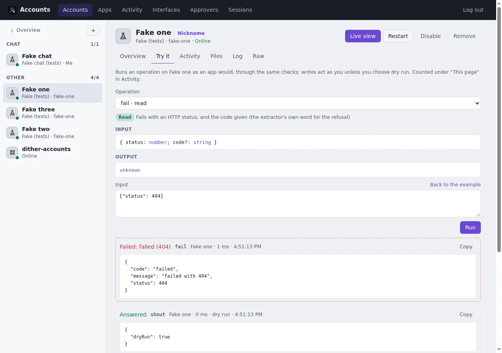
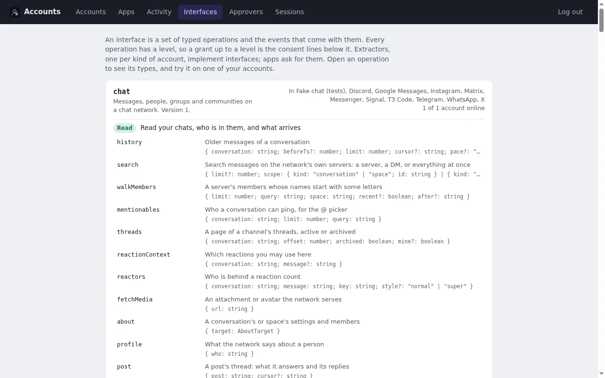
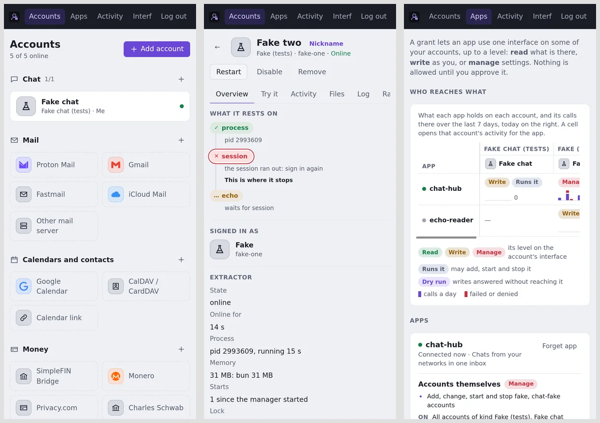

# dither-accounts

**Keep all your accounts signed in on your own machine, and decide exactly what each app may do with them.**

dither-accounts is a program you run yourself. It holds the logged-in session for each of your accounts: chat apps,
email, calendars, banks, shops. Your other programs (a chat app, a calendar, a budget tool, an AI agent) ask it for
access instead of asking for your password. You approve each request on one web page. You can narrow a request, test
it, or take it back at any time.



## Why it exists

- **Apps never see your passwords.** An app asks for something like "read your chats" or "send mail as you", on
  certain accounts. You approve it, and the app gets that and nothing more. Passwords, cookies and keys stay in the
  account's own folder. Only the code that runs that account can read them.
- **It works where there's no API.** Most services give your own programs no way to read your data. So here an
  account can run the service's own website in a sandboxed browser (walled off from the rest of your machine), or
  act as a linked device, the way the Signal and WhatsApp desktop apps do. If you can read something in the service's own app,
  an app of yours can read it too.
- **One place to see everything.** One page shows every account and its status, which apps can reach it, and how
  often they did. When an account breaks, the page shows which step failed: the browser, the sign-in, or the first
  sync.
- **You can try things safely.** You can approve an app as a dry run: when it tries to send or change something, it
  gets an answer, but nothing reaches the account. You can run every operation by hand from the page, and every call
  is counted.
- **It's yours.** It runs on your own machine, for you alone. Nothing goes through a hosted service.

## What you can connect

- **Chat:** Discord, Signal, WhatsApp, Matrix, Telegram, Google Messages (SMS and RCS through your phone), X direct
  messages, Messenger and Instagram direct messages. Also T3 Code's coding threads, each one a chat with its agent.
- **Mail, calendars and contacts:** Google (Calendar and Gmail, signed in through a sandboxed browser or through your
  own OAuth client), Proton Mail (in a sandboxed browser, or through Bridge), any IMAP server (with Gmail, Fastmail
  and iCloud presets), CalDAV and CardDAV, and read-only calendar feeds (ICS).
- **Money:** SimpleFIN Bridge, Charles Schwab, Privacy.com, Venmo, Amazon order history and a view-only Monero
  wallet. These only read: they pull statements and history for an app such as
  [dither-finance](https://github.com/libdither/dither-finance), and none of them can pay, trade or move money. A
  Haveno node (a peer-to-peer Monero exchange) is here too; with a write grant, an app can trade through it.
- **Other:** GitHub notifications, Njalla DNS records, error logs from your own services (bug watch), and Claude
  subscriptions for a CLIProxyAPI hub.

Each service has a page in [docs/](docs) ([list below](#docs)). It says what the service needs from you, and what
has only been checked on a real account.

## A tour of the page

Everything is done on one web page, served by the program itself.

### An app asks, you decide

When an app registers, it lists what it wants. The page shows each request in plain words (the test app in the
screenshot asks to "Hear echoes" and "Shout"). You can approve it as asked, or narrow it: a lower level, fewer
accounts, or a dry run.



### Who reaches what

A grid with a row for each app and a column for each account. Each cell shows:

- the app's level on that account (read, write or manage),
- whether the app runs the account,
- whether it's a dry run,
- a week of calls, with failures in red.

Click a cell to see that app's calls on that account.



### Where it breaks

Each account reports the chain of steps it depends on: display, browser, extension, sign-in, first sync. The page
marks the first step that isn't working ("This is where it stops"), so a broken account tells you where to look.



### Try any operation

You can run every operation an account offers from the page. It goes through the same checks, limits and dry run as
an app's call. The Interfaces page lists every operation with the exact types an app sees.

<table>
<tr>
<td width="50%"></td>
<td width="50%"></td>
</tr>
</table>

The page also has a **live view** of each sandboxed browser: you see and control that browser from the page, to sign
in or to watch it work. The page works on a phone and in dark mode.



## How it works

```
                 the page (accounts.example.net)
                                  │ approve / revoke / dry run
 dither-chat hub ─┐               ▼
 dither-calendar ─┼─ /consumer ─▶ manager ─ /extractor ─▶ extractors/discord, signal, matrix, whatsapp, google …
 any app ─────────┘   (calls, events)  grant → input → limit → audit → dry run → extractor
```

Apps talk to the **manager**, the one service in the middle. The manager checks each call and passes it to the
account. The words used on the page and in the docs:

- An **extractor** is the piece of code that runs one account. It might be a sandboxed browser on the service's own
  site, a sandboxed native app, a linked device, or an API login. Only code in this repo runs as an extractor. Apps
  never bring code of their own.
- A **kind** is a type of account, such as Discord, IMAP mail or Venmo. Each kind has its own extractor.
- An **interface** is a named set of operations with fixed input and output types, like `chat`, `mail`, `calendar`
  or `statements`. Each operation has a level:
  - **read**: look (history, profiles, a calendar's events)
  - **write**: act as you (send, react, edit, create an event)
  - **manage**: change settings and membership, or run the account itself
- A **grant** is your permission for an app to use one interface on some accounts, up to a level.
- A **dry run** is a grant whose writes are answered without reaching the account.

Every call goes through the same steps before it reaches the extractor: the grant check, an input check, rate limits
and call counting. A dry run answers the call at that point instead.

The manager passes calls and events between apps and accounts, and keeps none of what they say. It keeps only each
account's latest status and daily call counts.

For the full spec, every part of the page, and what an app that runs accounts may do, see
[docs/manager.md](docs/manager.md).

## Security model

dither-accounts holds live sessions and credentials for your accounts, so whoever controls it controls them. Know
where they are and who can reach them.

**Credentials are stored unencrypted, protected only by file permissions.**

- Each account has a directory, `<data>/accounts/<id>/` (mode 0700).
- Its `secret.json` (mode 0600) holds what you gave it: tokens, passwords, app passwords, and the private keys of the
  passkeys the account made for itself.
- Its browser profile or linked-device store (cookies, Signal and WhatsApp keys, Telegram's `tdata`) sits beside it.
- Anyone who can read your user's files, or a backup of the data directory, can act as you on every account. Use
  full-disk encryption and treat the data directory as a secret.

**Secrets stay with their extractor.**

- The manager writes `secret.json` and starts the account's extractor. The page and apps never see a secret's value,
  only which keys exist.
- Logs name steps and paths, not values.
- A passkey's private key never enters the browser. The extractor answers the service's WebAuthn calls itself, and
  checks which frames and origins may ask.
- The approver phone app ([docs/approver.md](docs/approver.md)) can hold passkeys instead, so each use needs your
  approval on the phone.

**Statement accounts only read.** The finance kinds that pull statements and history never pay, trade or move
money. (Haveno, the exchange, trades only for an app you gave a write grant.) The Monero kind is a view-only wallet: never give it a spend key.

**The page** answers only loopback and Tailscale addresses (100.64.0.0/10, fd7a:115c:a1e0::/48), and only behind a
login ([docs/auth.md](docs/auth.md)):

- one user, with a password kept as an argon2id hash and set only from this machine,
- a session cookie,
- writes accepted only from the page's own origin,
- failed logins backed off per address.

The manager listens on 127.0.0.1 unless you say otherwise. To reach it from other devices, put a reverse proxy with
TLS in front of it.

**Apps** get a token when they register (the manager stores only its SHA-256). They ask for interfaces at a level and
get only what you approve. Every call passes the grant check, an input check and rate limits, and can be answered by
a dry run. Only code in this repo runs as an extractor. Apps never bring code.

**Live views** (VNC of a sandboxed browser or app) listen only on a Unix socket in the account's directory. They
reach your browser only through the page, behind its login.

## Getting started

You need [Bun](https://bun.sh) (the version CI uses is in [.github/workflows/ci.yml](.github/workflows/ci.yml)).
The kinds that run a sandboxed browser or native app also need Xvfb, Chromium, x11vnc, bubblewrap and pasta on the
machine (or, on the wayland display backend, sway, wayvnc and grim in place of Xvfb and x11vnc: docs/browser.md,
"Display backends"). The other kinds need nothing more.

```sh
bun install
bun run web:build
export DITHER_ACCOUNTS_DATA=~/.local/share/dither-accounts      # state: accounts, sessions, the registry (0700)
mkdir -p -m 700 "$DITHER_ACCOUNTS_DATA"
cp config.example.toml "$DITHER_ACCOUNTS_DATA/config.toml"     # optional: every setting has a default
bun packages/manager/src/cli.ts set-password --file <file>     # the page's password (or on stdin)
bun packages/manager/src/main.ts                               # the manager and its page, on 127.0.0.1:8486
```

Open http://localhost:8486, sign in as `admin`, and add an account. Apps register themselves with the manager. Their
requests then wait on the **Apps** page until you approve them.

### Configuration

The manager's settings are in `<data>/config.toml`, in the `[manager]` table:

- the address and port the manager listens on,
- the page's URL as a browser opens it (`public_url`). The page accepts writes only from that origin, and passkeys
  and OAuth redirects are bound to it,
- where the built page is,
- whether to write trace files.

[config.example.toml](config.example.toml) lists every key with its default. A flag (`--public-url`) or its
environment variable (`DITHER_ACCOUNTS_PUBLIC_URL`) wins over the file. The data directory itself is set with `--data`
or `DITHER_ACCOUNTS_DATA` (default: `.data` in the checkout).

Each account's own settings (a homeserver, an email, which mail account carries its sign-in links) are set on the
page when you add the account, and kept in its directory.

### Running it for good

```sh
bun packages/manager/src/main.ts [--data <dir>] [--port 8486] [--host 127.0.0.1] [--public-url https://accounts.example.net]
```

It listens on 127.0.0.1 unless told otherwise. To reach the page from your other devices:

1. Put it behind a reverse proxy on this machine with your own name and certificate (Caddy on your tailnet, say).
2. Set `public_url` to that name.
3. Set `host = "0.0.0.0"` if the proxy reaches it at the machine's tailnet address rather than loopback.

A systemd user unit is a good home for it:

```ini
[Service]
WorkingDirectory=%h/src/dither-accounts
Environment=DITHER_ACCOUNTS_DATA=%h/.local/share/dither-accounts
ExecStart=/usr/bin/env bun packages/manager/src/main.ts
KillMode=mixed
Restart=always
```

The sockets and app registration answer only this machine. The page answers this machine and the tailnet, after the
login.

Restarting the service does not restart the accounts. Under systemd each extractor runs in a scope of its own and
keeps its session while the manager is away. The next manager adopts it. It restarts only the extractors whose code
changed, one at a time per kind. Stopping the service stops them all ([docs/supervisor.md](docs/supervisor.md)).

The command line covers the everyday jobs:

```sh
bun packages/manager/src/cli.ts accounts            # what runs, where
bun packages/manager/src/cli.ts apps                # apps, their grants and requests
bun packages/manager/src/cli.ts approve <request>   # or on the page
bun packages/manager/src/cli.ts import-dither-chat --hub-data <dither-chat data dir> --accounts <id>
bun packages/manager/src/cli.ts forget <id>         # hand an account back (its directory stays)
bun packages/manager/src/cli.ts set <id> <setting> on|off|<text>   # a kind's own setting (its manifest's `settings`, e.g. Signal's calls, Luma's city; "" clears a text one); restarts it
bun packages/manager/src/cli.ts set-password --file <file>   # the page's password (or on stdin); signs every browser out
bun packages/manager/src/cli.ts sessions | revoke-sessions   # the page's signed-in browsers
bun packages/manager/src/cli.ts export-to-dither-chat <id> --hub-data <dither-chat data dir>
                                                    # hand back one the manager made: copied, checked, then forgotten
```

How to move a dither-chat account here and back is in dither-chat's `docs/accounts.md`.

## Docs

- **How it works:** [manager.md](docs/manager.md) (the spec, the page, apps that run accounts, the code's layout),
  [auth.md](docs/auth.md) (the page's login), [supervisor.md](docs/supervisor.md) (extractors that outlive a
  restart), [notifications.md](docs/notifications.md) (the built-in notices account),
  [browser.md](docs/browser.md) (lending an account's signed-in browser to an app or agent),
  [signin-relay.md](docs/signin-relay.md) (a site's "Continue with Google" answered by a Google account here),
  [native-sandbox.md](docs/native-sandbox.md) (native apps in a sandbox), [page-traces.md](docs/page-traces.md) and
  [page-silence.md](docs/page-silence.md) (keeping hooks out of a page's sight; a page that stops answering),
  [passkeys.md](docs/passkeys.md) and [approver.md](docs/approver.md) (passkeys held by an account, or on your phone).
- **Chat:** [chat.md](docs/chat.md) (the chat extractors, and importing from dither-chat), [signal.md](docs/signal.md),
  [whatsapp.md](docs/whatsapp.md), [telegram.md](docs/telegram.md), [gmessages.md](docs/gmessages.md),
  [x.md](docs/x.md), [reddit.md](docs/reddit.md), [substack.md](docs/substack.md), [lesswrong.md](docs/lesswrong.md), [messenger.md](docs/messenger.md) (and Instagram), [t3.md](docs/t3.md),
  [mastodon.md](docs/mastodon.md), [lemmy.md](docs/lemmy.md), [bluesky.md](docs/bluesky.md), [zulip.md](docs/zulip.md),
  [partiful.md](docs/partiful.md), [luma.md](docs/luma.md).
- **Mail, calendars, contacts:** [google.md](docs/google.md), [proton.md](docs/proton.md), [mail.md](docs/mail.md),
  [dav.md](docs/dav.md), [ics.md](docs/ics.md).
- **Money:** [statements.md](docs/statements.md) (how the finance kinds hand over files), [simplefin.md](docs/simplefin.md),
  [schwab.md](docs/schwab.md), [privacy.md](docs/privacy.md), [venmo.md](docs/venmo.md), [amazon.md](docs/amazon.md),
  [monero.md](docs/monero.md), [haveno.md](docs/haveno.md).
- **Other:** [site.md](docs/site.md) (any website, kept signed in), [github.md](docs/github.md),
  [njalla.md](docs/njalla.md), [bugwatch.md](docs/bugwatch.md), [claude.md](docs/claude.md).

## Test

```sh
bun test                    # the manager over the real wire with fake extractors, both Google kinds against a fake Google (the browser one in a real Chromium), every chat extractor's own suite
bun run typecheck           # the services and the page (both tsconfigs)
bun scripts/verify-ui.ts …  # the page in headless Chromium against a fresh manager (see its header)
bun scripts/verify-chat-add.ts [shots]  # chat accounts added on the page reach a throwaway dither-chat hub (Matrix testbed, fake Signal and WhatsApp)
```

## Contributing

Pull requests are welcome. Read [AGENTS.md](AGENTS.md) first. Above all: no personal data in the repo (real names,
handles, account ids, amounts, hostnames, captured pages or sessions), whether in code, tests, fixtures or commit
messages.

CI ([.github/workflows/ci.yml](.github/workflows/ci.yml)) runs `bun run typecheck`, `bun run web:build` and
`bun run test`. The sandboxed kinds' tests are skipped on GitHub's runners (no Xvfb or Chromium). If your PR touches
those kinds, run their tests first on a machine that has both.

## Licence

dither-accounts is free software under the **GNU Affero General Public License, version 3 or later**
([LICENSE](LICENSE)): if you run a changed version for others over a network, offer them its source. Within it:

- `extractors/gmessages/bridge` is built on mautrix's libgm (AGPL-3.0-or-later, its own LICENSE).
- `extractors/haveno/proto` is haveno-reto's gRPC schema (AGPL-3.0; `grpc.proto` keeps Bisq's header), loaded only
  to speak to a node ([its README](extractors/haveno/proto/README.md)).
- The WhatsApp bridge links whatsmeow (MPL-2.0) and go.mau.fi/libsignal (GPL-3.0), so a built bridge binary is
  GPL-3.0, which the AGPL (section 13) lets it be combined with.
- The page uses noVNC and ical.js (MPL-2.0) and openpgp (LGPL-3.0-or-later) unmodified, from npm.

Brand marks on the page are Simple Icons (CC0-1.0); the names are their owners' trademarks, used only to say which
service an account is.
