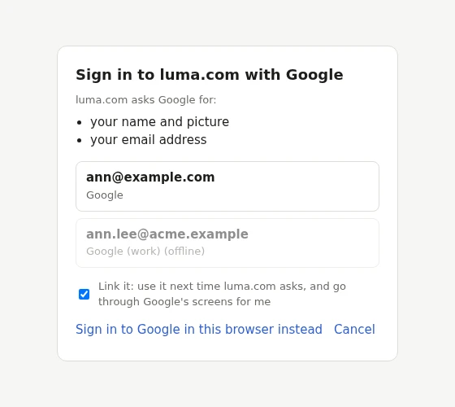

# Signing in with an account you already have here

A site's "Continue with Google" button can be answered by a Google account this manager already holds. Take Luma:
you click Continue with Google in the Luma account's live view, and the Google account's own browser, which is
already signed in to Google, answers it. You never sign in to Google inside Luma's browser, and Google's password and
cookies never leave the Google account's browser. Only the one-time code Google hands back moves, from one browser
to the other.

Today that means **Luma** asks and **Google** (the browser kind) answers. A kind takes part with a line in its
manifest and a few lines in its extension's worker (below).

## What you see

1. In the Luma account's live view, you click **Continue with Google**. Luma opens its popup on Google's sign-in
   link.
2. That link never loads in Luma's browser. The popup shows a chooser instead: **Sign in to luma.com with Google**,
   what Luma asks Google for ("your name and picture", "your email address"), and your Google accounts here, with the
   ones that are not online greyed out.

   

3. You pick one. "Use it next time luma.com asks" is on by default, so the next sign-in skips the chooser and goes
   ahead with that account. Picking with it off forgets the choice.
4. The Google account's browser opens the link in a tab of its own, in front. Luma's link asks Google to show the
   account picker and the consent screen every time (`prompt=select_account consent`), so the Google account shows
   an attention after a few seconds: **Google may be asking you to allow a sign-in to luma.com: answer it in the live
   view**. Answer Google there. A site that does not ask for that goes straight through.
5. Google sends that tab to Luma's redirect address with the code. The tab is stopped before it loads that address,
   so Luma's server never sees the Google browser. The address goes back to Luma's popup, which loads it: Luma trades
   the code for its own session, as it does after any Google sign-in, and the popup closes. A first sign-in this way
   makes the Luma account.

The chooser also offers **Sign in to Google in this browser instead**, which lets the link load in that one tab as
if none of this were here, and **Cancel**.

## How it works

```
Luma's browser                       manager                         Google account's browser
──────────────                       ───────                         ────────────────────────
tab heads for accounts.google.com
  blocked, goes to the chooser
  extractor: ask signin.choices ───▶ checks the link and the site
  chooser shows accounts      ◀───── choices, remembered one
you pick one
  extractor: ask signin.relay ─────▶ checks again ─── signin.authorize ──▶ opens the link in a new tab
                                                                          (you answer Google, if it asks)
                                                                          Google redirects to luma.com/google?code=…
                                                                          stopped before it loads
                                     checks the answer ◀── that address ──┘
  tab loads luma.com/google?code=… ◀─┘
  Luma signs itself in
```

- **The asking browser** (`packages/browser/src/page/signin-worker.js`, included in the kind's worker): a session
  block rule for each provider's authorize pages (`declarativeNetRequest`, which needs no host permission for a
  block), so not one request of the sign-in reaches Google from Luma's browser. The navigation it stops is still seen
  (`webNavigation`, the tab's update), and the tab goes to the chooser page (`signin.html`, which the sandbox adds to
  the extension's copy). The extractor (`SignInAsker`, `packages/browser/src/signin.ts`) asks the manager through its
  link's `ask`.
- **The manager** (`packages/manager/src/signin.ts`) checks every relay itself, whatever the asking extractor says:
  - the link is a provider's authorize page that answers with a code in the address (`response_type` has `code`, no
    `response_mode` but `query`, an https `redirect_uri`);
  - its `redirect_uri` is on one of the asking kind's own sites (its manifest's `signIn.sites`), so a code only ever
    goes to the site whose browser asked;
  - the answering account is enabled and of a kind that `signsIn` that provider;
  - what comes back is that redirect address, with a code or the provider's error.

  It sends the answering account `signin.authorize`, a command of the manager's own: no interface carries it, so no
  app can ask for it. A choice to remember goes in the asking account's config (`signInWith: { google: <account> }`).
- **The answering browser** (`SignInAnswerer`, and the same worker code): checks the link again, opens it in a new
  tab in front with a session rule that blocks only that tab from loading the redirect address, and answers with the
  address it was stopped at. The tab closes after (never the browser's last one). While it waits, the account's
  status asks you to answer in the live view. A relay waits up to five minutes for you.
- **Kept out of logs and statuses**: the link (its state, client and scopes ride in it) and the code. The logs name
  the accounts, the provider and the site.

## What it does not cover

- Sign-ins that answer by a **form post** (Apple's `response_mode=form_post`) or by **window messages** (Google's
  One Tap and its newer button library). The manager refuses those links and the chooser says why; "Sign in to Google
  in this browser instead" still works.
- Providers other than Google. A provider is a line in `packages/spec/src/signin.ts` (its hosts and authorize paths)
  and a browser kind that answers for it; GitHub, Microsoft or Discord would each need a browser kind of their own
  here first.
- Nothing here answers a provider's own checks: a captcha or a "verify it's you" in the Google account's live view is
  yours, as always.

## Adding it to a kind

Asking (a site with a "Continue with Google"):

- the manifest: `signIn: { sites: ['https://example.com'] }`;
- the worker: `/*@include signin-worker@*/`, `if (signinRelay.command(msg)) return;` first in its command routing,
  `signinRelay.start(sendUp, loadConfig().then((c) => c && c.signIn));` at its top level, and its tab reports leaving
  out `signinRelay.owns(t.id)`;
- the extractor: `signIn: signInConfig()` in the extension's config, and a `SignInAsker` whose `onMessage` sees the
  bridge's frames first.

Answering (a provider's own browser kind): the manifest's `signsIn: ['google']`, the same worker lines, and a
`SignInAnswerer` that takes the `signin.authorize` command.

## Tests

`test/signin-relay-unit.test.ts` reads links and runs the manager's checks against a registry in memory: the choices,
a relay and its answer, remembering and forgetting, and each refusal (another site, an account that cannot answer, an
asker that does not sign in, an answer that is not the redirect). `test/signin-relay.test.ts` runs a Google account
and Luma accounts in their own Chromiums against the fake Google and the fake Luma: a remembered account signs Luma in
with no click, Luma's browser never reaches Google's authorize page, neither log holds the code or the link, and on
the chooser a pick made with real keys (Tab, Enter on the account's display) signs in and is remembered.
